# Rysum – organ plugin (VST3 + Standalone)

Sample-based plugin of the Rysum organ (c. 1457, ¼-comma meantone, a′ ≈ 444.5 Hz),
7 stops, short octave C/E – a″ (41 keys), with a key-click/noise layer, per-pipe
placement in stereo or AmbiX up to 5th order, moving pipes and a degradation
("Verfall") section.

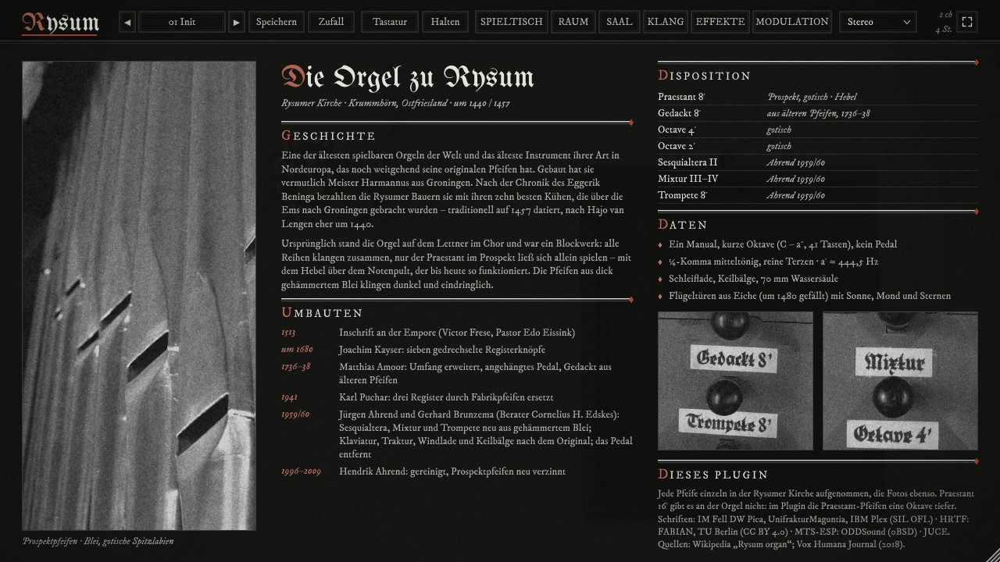

## 1. Build (Windows, once)

Needs: Visual Studio 2022 (workload "Desktop development with C++") and CMake.
Git is **not** needed – JUCE is downloaded as a zip on the first configure.

Open **PowerShell** and run:

```powershell
cd D:\RYSUM_plugin\rysum_plugin\plugin
cmake -B build -G "Visual Studio 17 2022" -A x64
cmake --build build --config Release
```

The first `cmake -B build …` downloads JUCE (~100 MB) and takes a few minutes.
The build itself takes a few minutes too. When it is done you have:

| what | where |
|---|---|
| VST3 plugin | `build\Rysum_artefacts\Release\VST3\Rysum.vst3` |
| Standalone app | `build\Rysum_artefacts\Release\Standalone\Rysum.exe` |

After changing code, only the second command (`cmake --build build --config Release`) is needed.

### Trying a new version next to the stable one

Build a second copy called **Rysum Dev** into its own folder. It has its own plugin ID, so
Reaper lists both and your old projects keep using the stable "Rysum":

```powershell
cd D:\RYSUM_plugin\rysum_plugin\plugin
cmake -B build-dev -G "Visual Studio 17 2022" -A x64 -DRYSUM_DEV=ON
cmake --build build-dev --config Release
```

Result: `build-dev\Rysum_artefacts\Release\VST3\Rysum Dev.vst3`. Add
`D:\RYSUM_plugin\rysum_plugin\plugin\build-dev\Rysum_artefacts\Release\VST3` to Reaper's VST
paths once and re-scan. When you're happy with a new version, rebuild the stable one
(`cmake --build build --config Release`, with Reaper closed).

## 2. Use it in Reaper

Either copy the whole `Rysum.vst3` folder to `C:\Program Files\Common Files\VST3`
(needs admin rights), **or** add the build folder to Reaper:
*Options → Preferences → Plug-ins → VST → Edit path list → add*
`D:\RYSUM_plugin\rysum_plugin\plugin\build\Rysum_artefacts\Release\VST3`, then *Re-scan*.

**The samples are not part of this repository.** The recordings of the Rysum organ belong to the author and
are not published here; the code, the documentation and the build are. Without the sample library the plugin
builds and opens, but the seven sampled stops stay silent (the Vox humana, the synthesised sounds and the effects
still work). If you have the library, the plugin finds it by itself in a folder `rysum-samples` at the root of the
repository; if it is somewhere else, click **Samples-Ordner …** on the Spieltisch page and choose the folder that
contains `rysum_samples.json`. The preparation script `scripts/rysum_preprocess.py` makes that folder from the raw
recordings.

### Stereo
Output "Stereo" (dropdown at the top right). The plugin writes to channels 1/2.

### Ambisonics (AmbiX, ACN/SN3D)
1. Set the track to enough channels: click the track's **Route** button →
   *Track channels*: 4 (1st order), 9, 16, 25 or **36 (5th order)**.
2. In the plugin choose the output format in the dropdown at the top right (Stereo or
   AmbiX 1.–5. Ordnung). Next to it you see how many channels that needs; it turns white
   with a warning if the track has fewer.
3. Decode after the plugin, e.g. IEM *BinauralDecoder* (headphones) or *AllRADecoder*
   (speakers) – the format is the same as the IEM suite (ACN order, SN3D).

The plugin's output bus is declared as 5th-order Ambisonics (36 ch). In stereo
and binaural mode only channels 1/2 carry sound.

### Binaural (headphones) – also in Ableton and the standalone app
Output "Binaural (Kopfhörer)". The plugin renders Ambisonics internally and decodes it to
two ears with head-related transfer functions, so a normal stereo track is enough (Ableton,
Reaper stereo track, the standalone app – which starts in this mode). Settings are on the
**Klang** page (*Kopfhörer*):
- *Ordnung* 1–5 (default 3): higher = sharper directions, more CPU.
- *SOFA laden …*: your own HRTF set in the SOFA format (convention SimpleFreeFieldHRIR, e.g.
  an individually measured one or one from the SOFA databases); *FABIAN* goes back to the
  built-in set. The file path is saved with the project (not in patches).
- *Kopfdrehung*: turns the whole scene as if you turned your head (also a modulation target –
  an LFO on it is a quick way to check what is where).
- *Diffusfeld-Entzerrung* (on): removes the average colouration of the HRTF set, for
  diffuse-field-tuned headphones. Off = the dummy head as measured.

How it works – the same approach as the IEM *BinauralDecoder*: from the HRTF set the plugin
computes a magnitude-least-squares (MagLS) decoder for the chosen order (Schörkhuber,
Zaunschirm & Höldrich 2018): below ~620 Hz × order the HRTFs are fitted exactly (correct
interaural time differences), above only their magnitude (no dull treble at low orders), then
the diffuse-field energy is matched. This takes about half a second in the background whenever
the order, the HRTF or the sample rate changes. The built-in HRTF is the **FABIAN** head and
torso simulator of the TU Berlin (2000 of the 11 950 measured directions). Latency of the
binaural decoder: 128 samples.

## 3. The pages

**Language (English / Deutsch):** the interface is in English by default. The small **EN / DE**
button at the far right of the top bar (next to the full-screen square) switches it to German and
back; the lit code is the current language. The switch is immediate: the interface is rebuilt on the
same page, nothing about the sound changes. The choice is remembered on this computer
(`Documents/Rysum/Sprache.xml`) for the plugin and the standalone app; `RYSUM_LANG=de` or `en` forces
a language for one run without saving it. Parameter IDs, patches, projects and MIDI mappings do not
depend on the language; host automation lists keep the German parameter names. Patch names and
the bundled pieces stay German. This README and the paper use the German control names; in English
the pages are *Console* (Spieltisch), *Sound* (Klang), *Effects* (Effekte), *Modulation*,
*Timeline* (Verlauf), *Saal*, *Room* (Raum) and *Walk* (Begehen).

**Top bar, next to the patches:**
- *Tastatur*: play with the computer keyboard. `A W S E D F T G Z H U J K O L P` = C up to
  d♯ of the next octave (German layout: Z is the black key between G and H), `Y` / `X` = octave
  down / up (the button shows the octave), `C` / `V` = softer / harder touch (key clicks). In a
  host click into the plugin window first; in Ableton switch off Live's own computer MIDI keyboard
  (the keyboard button at the top right of Live) so the keys reach the plugin.
- *Halten*: strike a key twice quickly and the note stays down, as if you kept holding it – the
  pipes sound normally (no Freeze), so you can pull stops, change the wind and modulate with free
  hands. Strike it once more to let it go; switching *Halten* off lets all held notes go. The
  button shows how many notes are held. Works with MIDI, the computer keyboard and the keyboard
  on the Spieltisch page.

- **Full screen** (the square at the far right of the top bar, or `F11`): the whole interface fills
  the screen the plugin window is on, scaled up as far as the screen allows. `Esc`, `F11` or the button
  again brings it back into the plugin window. While it is full screen, the plugin window just shows
  where it went; clicking it also brings the interface back. This works the same in Reaper, Ableton
  and the standalone app. The interface is 16:9 (1280 x 720), so on a full-HD screen it fills the
  whole screen at 1.5x.
- **Window size**: the first time, the plugin window opens about as large as the screen allows
  (on a 1920 x 1080 screen roughly 1.3x). Drag the corner to change it (half to twice the size); the
  size you leave it at is remembered for every new instance (`Documents/Rysum/Fenster.xml`;
  delete that file to get the automatic size again).

**Every slider:** click its value to type a number (in the units shown: `50` on a % slider
= 50 %, `300 ms` or `1.5 s`, `440` on the Stimmton = A4 in Hz, `22` on Abtastrate = 22 kHz),
Return applies. Double-click the slider = default. Right-click = modulation.

**Stops:** eight – the seven recorded ones plus a *Praestant 16′*, made from the Praestant 8′
samples played an octave lower (it comes first in the lists; its parameters are added after the
others, so older projects and patches still load). Default volumes are set so all stops start
about equally loud (measured K-weighted loudness of all pipes, including their default distance).

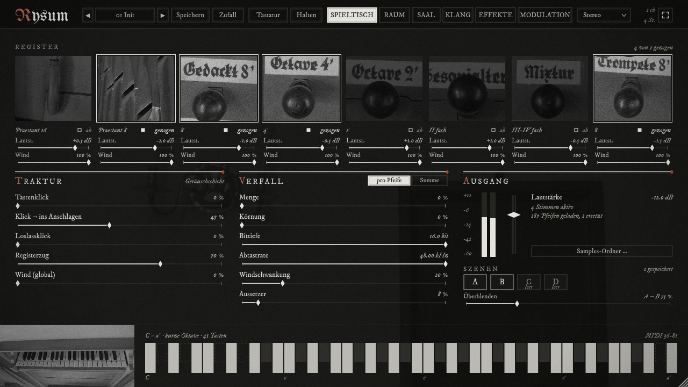

**Spieltisch** – click the stop knobs (photos) to pull/push stops. Under every stop:
*Lautst.* (volume, −48…+12 dB) and *Wind* – how far the stop is drawn: below 100 % the
pipes get quieter, flatter, unsteady and duller, at 0 % they are silent (move it while
holding chords). *Traktur* is the noise layer (key click, how much of the click goes into
the pipe's attack position, release click, stop-pull sound, *Wind (global)*: blower noise,
and above ~35 % an increasingly unstable wind supply that shakes the pitch and level of
all pipes together – wild at 100 %). *Verfall* is the degradation: amount, grain,
bit depth, sample rate, unstable wind (pitch/level wobble), dropouts – applied to
each pipe before it is placed in space ("pro Pfeife") or to the whole output
("Summe"); *Windschwankung* also gets disproportionately wilder towards 100 %. The
keyboard strip can be clicked to play.

**Vox humana** – a ninth stop without samples: a neural network (NeuralRysum v2, trained on
renderings of this plugin; see `docs/NeuralRysum_v2_paper.md`) synthesises the organ from the
held keys, in the plugin's tuning (temperaments, Stimmton, Scala, MTS-ESP). On the Spieltisch it
has a knob like the other stops with *Lautstärke* and *Wind* (less wind = duller, breathier,
quieter). *Vox …* opens the rest:
- the timbre: *Klangfarbe X / Y* (moves through the registrations the network has learned),
  *Helligkeit*, *Hauch* (noise), *Breite*; *Klangfarbe folgt dem Eingang* lets the audio input's
  brightness steer the timbre instead of the knobs;
- *Eingang spielt die Orgel*: the network listens to the audio input (a voice, a guitar, a mix),
  finds up to 8 notes in it and plays them – on the Vox humana and, as notes on MIDI channel 16
  folded into the compass, on the pulled sample stops. *Erkennungsschwelle* (higher = fewer, surer
  notes), *Bestätigung* (how long a pitch must be heard before it starts), *Stimmen* (1–8).
- On the Raum page it has its own row under the audio input: *Lautstärke*, *Hall-Anteil*,
  *Richtung*, *Höhe*, *Abstand* and *eigener Raum* (its learned room); drag its symbol in the top
  view. It is placed like the audio input (rooms, early reflections, everything after the pipes).
- In the 3D Saal its eight voices are glass pipes as long as the pitch they sing, with collars that
  light up with the bands of their harmonics (16′, 8′, 5⅓′, 4′ …).
- All its controls are modulation targets (group *Vox humana*) and can have Verlauf lanes.
- Weak spots: the lowest octave is detected slowly and sometimes an octave too high, a key repeated
  quickly becomes one note, a dense mix is reduced to its 8 strongest pitches. CPU: about 4 % of
  one core played from the keys, 15 % with the input playing it.

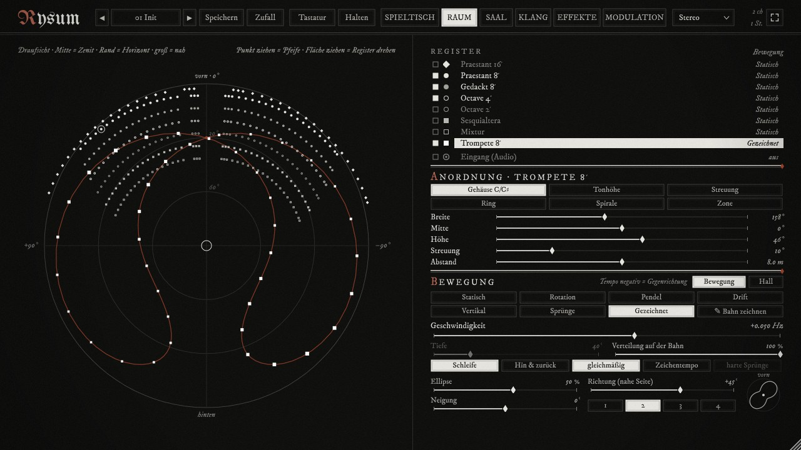

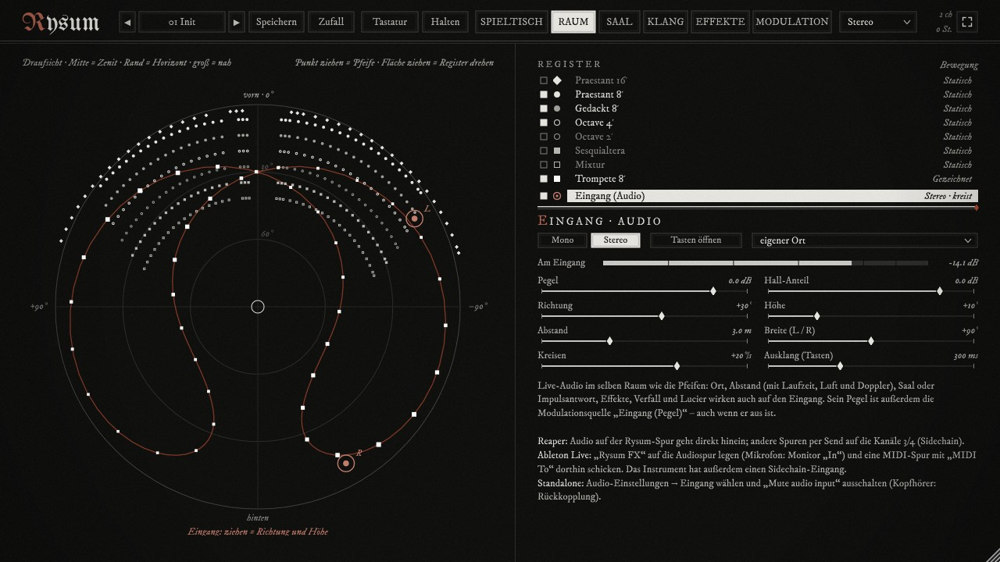

**Raum** – every pipe of every stop as a small dot (top view: centre = zenith, edge = horizon,
outside the circle = below the horizon). Select a stop on the right, then
- drag a dot to move one pipe,
- drag on empty space to turn the whole stop around you,
- *Anordnung*: layout generators (organ case C/C♯ side, pitch, scatter, ring,
  spiral, zone) with width / centre / height / spread / *Abstand* (distance, 1–40 m,
  continuous; bigger dots = nearer),
- The lower part has two tabs, *Bewegung* and *Hall* (buttons in its title line).
- Tab *Pfeife* (the sound of this stop's pipes): besides Ansprache, Abriss and Obertöne, the stop's
  own effects on top of the global ones – *Tremulant* (a tremulant for this stop alone, at the
  tremulant's tempo from the Klang page), *Knistern* (crackle at its sounding pipes),
  *Windleck* (two leaks at its pipes that hiss while the stop is drawn and move with the pipes),
  *Tempo-Streuung* (every pipe turns, tilts, swings or drifts a little faster or slower than the
  stop: a circle becomes a swarm that pulls apart; changing it never makes a pipe jump).
  *für alle Register übernehmen* copies all of them to every stop.
- *Bewegung*: Statisch, Rotation (horizontal), Pendel, Drift, Vertikal (turns over your
  head: front → up → back → down), Sprünge (every pipe suddenly jumps to a new random place
  around its position, each at its own moment; *Tiefe* = how far), Gezeichnet (see below).
  *Geschwindigkeit* runs from −500 to +500 Hz (fine at slow speeds, the knob gets coarser
  towards the top): negative = the other direction. Changing the speed never resets the
  position, so you can do smooth speed glissandi (also by automation). Positions are
  computed every 64 samples, so above ~300 Hz the motion itself starts to alias – a sound of its own.
  - *harte Sprünge* (Sprünge only): no smoothing at all. The place changes at the exact sample,
    so jumps click; from ~50 Hz on it buzzes and rattles.
- *Gezeichnet* – draw your own trajectory: press *✎ Bahn zeichnen*, then draw a line in the top
  view with the mouse held down (centre = overhead, edge = horizon, outside = below). When you
  let go, the stop switches to *Gezeichnet* and its pipes travel along the line like a train
  (the line stays visible in red). *Geschwindigkeit* = passes per second.
  - *Verteilung auf der Bahn*: 0 % = all pipes of the stop together at one point, 100 % = spread
    over the whole path (along the keyboard). It is modulatable.
  - *Schleife*: at the end back to the start (the path closes). *Hin & zurück*: forwards, then
    backwards.
  - *gleichmäßig*: even speed along the path. *Zeichentempo*: as fast as you drew, so fast
    where you drew fast and slow where you drew slowly.
  - The distance stays the pipe's own (*Abstand*, layout). The ellipse below still applies.
  - Paths are saved with the project and in patches; drawing again replaces the path.
- *Ellipse* – the shape of the orbit, for every motion. *Ellipse* = how much nearer the near
  side is (and the far side farther); this gives Doppler (see Klang).
  - *Richtung*: where the near side is (0° = front); modulate it and the ellipse turns.
  - *Form*: *1* = one near side (you are at a focus, as before), *2* = near on two opposite sides
    (you in the centre of the ellipse), *3* / *4* = triangle / square-like orbits.
  - *Neigung*: the orbit tilts – higher towards the near side, lower on the far side (negative:
    the other way).
  - The small picture shows the orbit from above (front up). Defaults are as before, so older
    projects sound the same.
- *Hall*: load an impulse response (*IR laden …*: WAV/AIFF/FLAC, up to 10 s). 4/9/16/25/36
  channels are read as AmbiX (ACN/SN3D); switch on *N3D* for N3D-normalised files, *FuMa* for
  first-order B-format in FuMa order (W X Y Z). 2 channels = stereo, 1 = mono. Files with other
  channel counts (e.g. 32 raw Eigenmike capsules) have to be encoded to Ambisonics first.
  - *folgt Pfeifen*: the IR is turned so that its direct sound and early reflections (first
    ~80 ms) come from each pipe's own direction – every pipe gets "its" room. Off = the room
    exactly as measured (early reflections from where the measurement loudspeaker stood).
  - *Umhüllung*: blends the late tail with an even, decorrelated field from all sides
    (energy per order like a real diffuse field). This also turns mono / stereo / first-order
    IRs into an enveloping room up to the *Ord.* chosen.
  - *Direktschall der IR*: how much of the IR's own direct sound is kept (the dry pipes already
    are the direct sound; default 20 %).
  - *Ord.*: highest Ambisonics order of the room (default 3; the pipes stay at full order).
    Higher orders cost more CPU: a 5th-order room with a long IR is heavy.
  - *Direkt* and *Hall* set the dry and room levels, *x* removes the IR. The IR is resampled to
    the project rate and normalised automatically; changing these settings or the output format
    rebuilds the room in the background (~½ s).

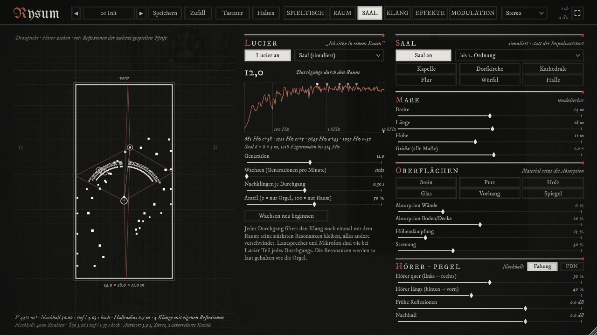

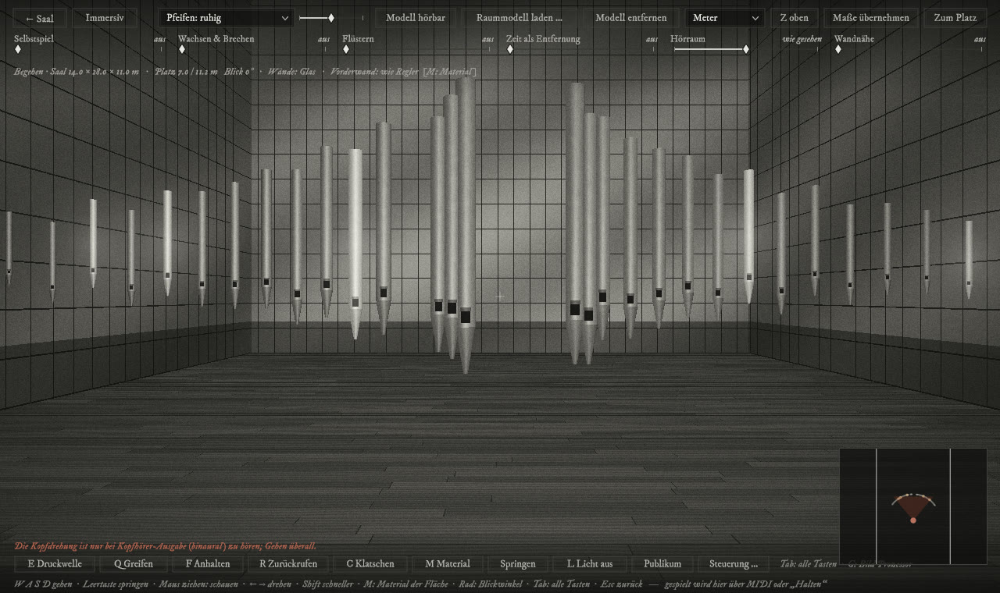

**Saal** – a simulated room instead of the impulse response, made to be played. *Saal an*
switches it on (the IR on the Raum page pauses meanwhile and comes back when it is off).
- How it works:
  - *Early reflections*, per sound: every sounding pipe (and every click / own sound) gets its own
    mirror-image sources in the shoebox room, up to the 1st, 2nd or 3rd order (6, 24 or 62
    reflections), each from its own direction, with its own delay, wall and air damping. Pipes
    that move get their reflections moving with them, with their own Doppler shift. The first
    reflections are encoded at up to 3rd order, the later ones at 1st order (cheaper, and they
    are diffuse anyway).
  - *Late reverb*: the way room-acoustics software (e.g. RAVEN) does it. **Ray tracing**
    (4000 rays with specular and diffuse reflections and air absorption) gives the room's decay
    in two bands; from it a dense noise response is synthesised – one independent noise per
    Ambisonics channel with the energy of a diffuse field (up to 2nd order; stereo: two) – and
    convolved with the organ. A noise response has no modes. Ray tracing matters when
    the absorption is uneven or the room is not diffuse: a corridor with hard walls rings far
    longer than Eyring's formula says. The tail's level follows the room's critical distance
    (big, damped rooms are drier, small hard ones wetter).
  - *Nachhall: Faltung / FDN* (buttons in the *Hörer · Pegel* title): the late reverb can also
    be a **feedback delay network**, the earlier model: 16 delay lines around the room's mean
    free path, a random orthogonal mixing matrix, slowly modulated delays, decay per band from
    the same ray tracing, the lines spread over 16 directions. It sounds a little more alive
    and grainy and needs less CPU. Both are set to the same level. When you switch while
    playing, the old tail rings out underneath, so there is no gap. (The ringing heard in
    earlier versions was a precision bug in the delay lines of the early reflections and of
    the FDN, which made both alias after a few minutes of running. It is fixed in both.)
  - When the room changes – also while it is modulated – a new response is built in the
    background (about four times a second while it keeps changing) and crossfaded in. The
    convolution keeps the input history apart from the response, so the reverb that is already
    sounding simply turns into the new room's, without a gap; the noise is the same for every
    rebuild, so held tones do not jump. The tail follows the room ~¼–½ s late, the early
    reflections immediately. Responses are at most 6 s long.
- The plan shows the room from above, the pipes of the pulled stops inside it (pipes outside
  the walls are pushed in), the listener (drag it), the four mirrored rooms and, in red, the
  reflections of the last pipe you played: its mirror images and the paths over the walls.
- *Maße*: width, length, height and *Größe* (scales all three – the easiest knob to modulate).
  Room buttons: Kapelle, Dorfkirche, Kathedrale, Flur (flutter echo), Würfel (a small, almost
  lossless box that rings like an instrument), Halle.
- *Oberflächen*: absorption of the walls and of floor/ceiling, extra damping of the highs,
  *Streuung* (how much is reflected diffusely: less in the reflections, more in the tail).
  Material buttons set them: Stein, Putz, Holz, Glas, Vorhang, Spiegel (nothing is absorbed –
  an impossible room).
- *Hörer · Pegel*: where you stand (also by dragging in the plan), level of the early
  reflections and of the tail.
- Everything is a modulation target ("Saal" in the list): an LFO on *Größe* makes the room
  breathe, envelopes can shrink it while a chord is held, LFOs on the listener let you walk
  through it. Patches 49–55 show some of this.
- CPU: reflections up to 2nd order are the sensible default; 3rd order with many pipes is heavy.
  Up to 48 sounds get their own reflections at a time (all of them still reach the tail).

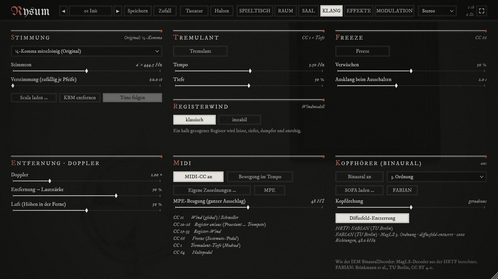

**Klang**
- *Stimmung*: besides the historical temperaments below there are exotic tunings. Twelve notes
  per octave: just intonation (5-limit on C, septimal 7-limit), the harmonic series on C
  (partials 16–30: the 7th, 11th and 13th partials sound very foreign), 12 of 31-EDO, 12 of 19-EDO,
  12 of 53-EDO (almost just), Maqam Rast (E and B a quarter tone low). Step tunings – every MIDI
  note is one step, so the keyboard becomes microtonal: 31-EDO (38.7 ct), 19-EDO (63.2 ct),
  quarter tones (50 ct), Bohlen–Pierce (13 steps per twelfth, 146.3 ct, no octaves at all) and
  Wendy Carlos's Alpha (78 ct). For those every key takes the recorded pipe closest to its new
  pitch, so the pipes hardly need to be shifted (31-EDO: at most 40 ct). a′ stays where it is.
- **Free tuning – Scala and MTS-ESP** (the last two entries of the list). Here every MIDI note,
  on every MIDI channel and over the whole range 0–127, gets its own pitch. The recorded pipe
  nearest to that pitch plays, shifted by the rest. Its sound comes from that pipe's place.
  Notes that land on the same pipe (31-EDO steps, clusters) each get their own voice. Notes
  beyond the organ's compass are shifted from the outermost pipes, up to two octaves (further
  out they stay silent). Velocity, modulation, Halten and Freeze work as usual.
  - *Scala-Datei (.scl / .kbm)*: without a loaded file, this plays 12edo at A4 = 440 Hz
    and displays Stimmton C4 (MIDI 60), 261.625565 Hz. *Scala laden …* takes a scale (`.scl`, cents or ratios) and,
    loaded afterwards, a keyboard mapping (`.kbm`: which key plays which degree, unmapped keys,
    reference key and frequency). *KBM entfernen* goes back to the default mapping: degree 0 on
    C4 (MIDI 60) at 261.625565 Hz, the 12edo C at A4 = 440 Hz. The Stimmton row shows
    the reference MIDI note and frequency supplied by the KBM, or this default reference.
    Scala tuning uses these absolute frequencies independently of the normal Stimmton setting.
    The files themselves are saved in the project and in patches, so they also work on
    another computer. Loading a file selects this entry.
  - *MIDI Tuning (MTS-ESP)*: follows an **MTS-ESP master** (ODDSound; e.g. the free
    *MTS-ESP Mini*, or a master in another plugin), including multi-channel tables (keyboards with
    more than 128 keys, e.g. Lumatone layouts) and keys the master leaves unmapped. Without a
    master it takes **MIDI Tuning Standard SysEx** from the MIDI input: that is what Hexatone
    and similar isomorphic-keyboard tools send. *Töne folgen*: held notes follow a tuning change
    at once (off: each note keeps the pitch it was struck with). Until a master is connected or
    SysEx has arrived, it plays calibrated 12edo at A4 = 440 Hz, independently of the stored
    Stimmton setting. This mode hides Stimmton and puts *Töne folgen* in its place. The status
    identifies the fallback; received tuning is shown as *MIDI Tuning (MTS-ESP) empfangen*.
    MTS-ESP needs its library installed (it comes with every MTS-ESP master); without it the
    plugin works as before.
  - **Hexatone via MIDI loopback** (loopMIDI on Windows, IAC on macOS): in the **standalone
    app** choose the loopback port as MIDI input (*Options → Audio/MIDI Settings*), select
    *MIDI Tuning (MTS-ESP)*, and let Hexatone send MTS SysEx on that port. In **Reaper** the
    track's MIDI input passes SysEx on. **Ableton Live does not pass SysEx to plugins.** There,
    use an MTS-ESP master (e.g. MTS-ESP Mini with the same scale) and send Hexatone only notes.
- Historical temperaments (¼-comma meantone = the original recording, ⅙-comma,
  Werckmeister III, Kirnberger III, Vallotti, Pythagorean, equal). a′ stays put, the other
  pitch classes are shifted. *Stimmton* moves everything (±200 ct, shown as A4 in Hz).
  *Verstimmung* gives every pipe its own fixed random detune (0–60 ct).
- *Tremulant*: on/off, speed, depth – pitch + level wave shared by all pipes, plus a bit
  of wind noise.
- *Registerwind* – the wind model of the stops, i.e. what the *Wind* slider of each stop
  (Spieltisch) does when it is turned down:
  - *klassisch* (default, as before): a half-drawn stop gets quieter, flatter, duller and unsteady.
  - *instabil*: the same, and below roughly half wind each pipe also gets an edge tone. That is
    the slow jet oscillating at the upper lip: a thin whistle (roughly 1.5–8 kHz) next to the pipe tone.
    Like on a real organ it is
    - steady as long as the wind is steady;
    - lower and quieter as the wind falls (its pitch follows the jet speed, about the square root of
      the pressure);
    - pulled towards the pipe's own resonances, so on some pipes it moves in small hops instead of
      gliding (a stopped Gedackt only has the odd ones);
    - different from pipe to pipe (where it appears, how high, some pipes have a second, weaker
      one), but always the same for the same pipe.
    The mouth also hisses, and at very low wind (below ~15 %) the speech sputters. The Trompete
    chatters instead. At full wind nothing changes, so patches sound the same in both models.
    Try a slow LFO or an envelope on a stop's wind, or a MIDI fader (see section 4). Patches 56–58 show it.
- *Freeze*: while on, released notes do not stop but turn into a grain cloud from the
  pipe's sustain. *Verwischen* = longer, more detuned grains. Switching it off lets the
  frozen notes fade over *Ausklang*.
- *Entfernung · Doppler*: *Doppler* (pitch shift when a pipe's distance changes – with
  Ellipse or Drift; Sprünge never glide), *Entfernung → Lautstärke* (far pipes quieter),
  *Luft* (far pipes duller). Far pipes also send more into the Hall.
- *MIDI*: *MIDI-CC an* switches the fixed CC mapping (section 4); *Eigene Zuordnungen …*
  opens your own controller assignments (MIDI learn); *Bewegung im Tempo* locks all
  motion to the host tempo and song position (speeds count as written at 120 BPM; for
  free speed glissandi switch it off).
- *Kopfhörer (binaural)*: *Binaural an* switches the output to binaural (and back to
  stereo), order, own SOFA file, head rotation, diffuse-field EQ – see section 2.

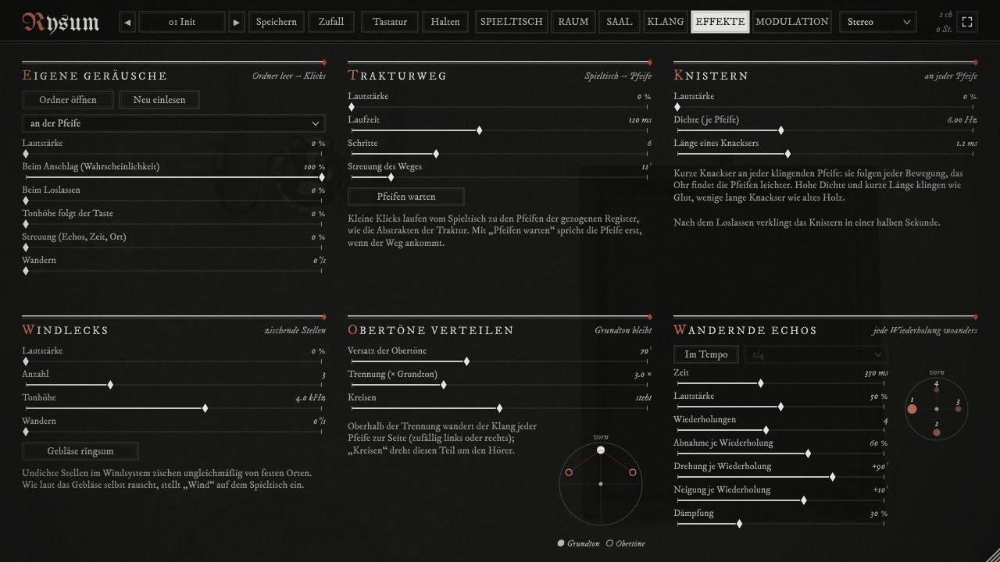

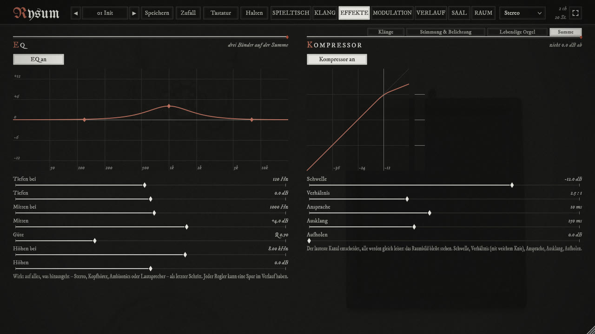

**Effekte** – sounds that are easy to locate (short, bright, full of transients) and that
follow the pipes. Everything is off in older patches.
- Tab *Summe* (mixing / mastering): the last step of everything that goes out – stereo,
  headphones, Ambisonics or loudspeakers. An *EQ* with three bands (low shelf, a bell with
  *Güte*, high shelf; the curve is drawn) and a *Kompressor* (Schwelle, Verhältnis with a soft knee,
  Ansprache, Ausklang, Aufholen; its line and how much it turns down now are drawn). The loudest
  channel decides and all channels are turned down together, so the spatial image stays put.
  Every control can have a lane in the Verlauf.
- *Eigene Geräusche*: your own recordings, played by the keys. Put WAV/AIFF/FLAC files
  (up to 20 s, up to 64 files) into `samples\noise\eigene` – *Ordner öffnen* creates the folder
  and opens it, *Neu einlesen* reads it again without reloading the pipes. Each file is trimmed
  to its first transient and set to the same peak level. With an empty folder the recorded key
  clicks are used. *Ort*: at a pipe of a pulled stop, anywhere in the room, at the
  console, or circling. *Beim Anschlag / Loslassen* = probability per key, *Tonhöhe folgt der
  Taste* = pitch follows the key (100 % = semitones), *Streuung* adds delayed copies at other
  times and places, *Wandern* lets each sound travel around you (°/s). Velocity sets level and
  brightness, like the key clicks.
- *Trakturweg*: small ticks travel from the console to the pipes of the pulled stops (the
  trackers), *Laufzeit* = travel time, *Schritte* = number of ticks, *Streuung* = how far the path
  bends. *Pfeifen warten*: the pipe only speaks when the path arrives.
- *Knistern*: short crackles at every sounding pipe – they move with the pipe, so the ear finds
  it. *Dichte* per pipe (Hz), *Länge* of a crackle (ms).
- *Windlecks*: up to eight hissing leaks at fixed places (they can wander). *Gebläse ringsum*:
  the blower noise (*Wind* on the Spieltisch) comes from all sides instead of one signal.
- *Obertöne verteilen*: above *Trennung* (× the pipe's fundamental) each pipe's sound is moved
  sideways (randomly left or right per pipe) – the fundamental stays at the pipe. *Kreisen*
  turns the upper part around you.
- *Wandernde Echos*: up to eight repeats of the whole organ, each from the next direction
  (*Drehung*, *Neigung* per repeat), quieter by *Abnahme* and darker by *Dämpfung*. *Im Tempo*
  uses a note value instead of *Zeit*. The little circle shows where the repeats come from
  (top view, front up). Echoes also go into the Hall from their own direction.

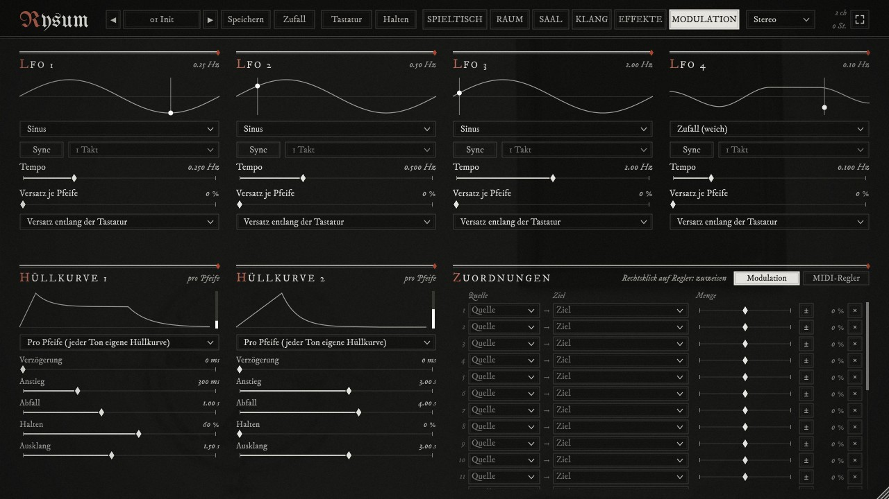

**Modulation**
- *LFO 1–4*: shape (sine, triangle, saw, square, random steps, smooth random), *Tempo*
  0.01–20 Hz or *Sync* to the project tempo (note values), *Versatz je Pfeife* (spread):
  0 % = all pipes move together, 100 % = one full cycle spread across the pipes – along the
  keyboard (a wave running from low to high) or randomly. The dots in the display show
  where each key's pipe is on the wave. Spread only acts on the *Pfeife:* targets.
- *Hüllkurve 1–2* (envelopes): delay, attack, decay, sustain, release. *Pro Pfeife* = every
  note runs its own envelope; *Global* = one envelope, every key restarts it and it
  releases when all keys are up. Global targets (any parameter) always follow the global
  envelope.
- Further sources: *Tastenlage* (low key −1 … high key +1), *Modrad* (CC 1), *Zufall je Ton*
  (a new random value per key press), *Anschlag* (key velocity 0 … 1, per note – each pipe keeps
  the velocity its key was struck with; global targets follow the last note), *Tonhöhenrad*
  (pitch wheel −1 … +1; it bends nothing by itself – route it to *Pfeife: Tonhöhe*, e.g. 17 %
  = ±2 semitones, or anywhere else).
- *Zuordnungen* (24 slots, scroll the list): source → target, amount ±100 % (click the
  amount to type it), and **± / +**: ± = bipolar (an LFO swings around the slider value),
  + = unipolar (it only pushes one way, 0 … amount; envelopes and the mod wheel are 0 … 1 anyway).
  Targets:
  - *Pfeife: Richtung / Höhe / Abstand / Lautstärke / Tonhöhe / Helligkeit / Hall-Anteil* –
    act on every pipe separately (at 100 %: ±180°, ±90°, ×8 distance, ±36 dB, ±12 semitones,
    ±6 octaves of brightness, ±24 dB room send);
  - every continuous parameter of the plugin (stop volume, motion speed, wind, Verfall,
    Doppler, Hall, even the LFO speeds themselves …), amount = share of the slider's range.
- **At the slider itself:** a modulated slider shows each routing's range as a red bar with a
  small red lozenge at the full-amount end – drag the lozenge to set the amount right there
  (Shift = 5 % steps); the white tick shows where the modulation is right now.
- **Right-click any slider** → *Modulieren mit …* picks a free slot directly (or removes an
  existing one). A modulated slider shows a white bar and arrow where the modulation takes it
  right now. In the Raum view the pipes move with *Pfeife: Richtung / Höhe / Abstand*
  modulation (silent pipes show the LFO part; sounding ones also their envelopes).
- Everything is updated every 64 samples (≈1.3 ms), so even fast LFOs stay smooth. Amounts
  are automatable parameters; sources and targets of the slots are saved with the project.
- **MIDI-Regler** (the second tab of *Zuordnungen*): knobs, faders and buttons of your MIDI
  keyboard on any control of the plugin – see section 4.

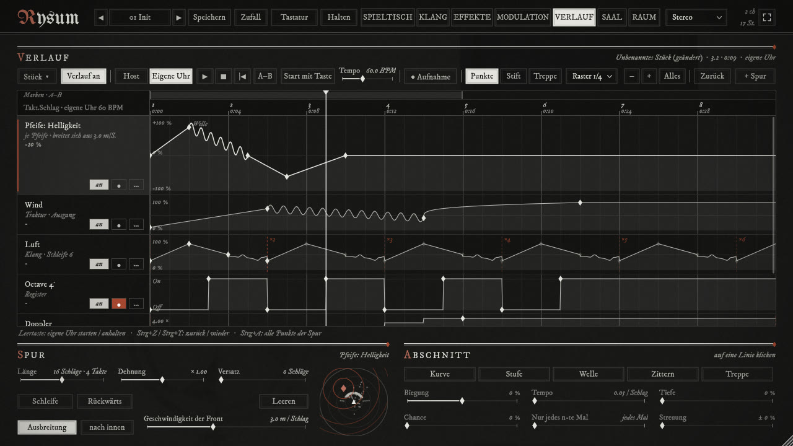

**Verlauf** – automation over time, like the automation lanes of a DAW, but inside the plugin
and with things a hand can't do: exact, long, synchronised changes of many controls, textures,
loops of different lengths running against each other.
- *+ Spur* adds a lane for a control (up to 16), or right-click any slider → *Im Verlauf
  automatisieren*. Besides every slider, a few switches can have a lane too: the stops
  (*gezogen*), the motion of each stop and its *harte Sprünge*, Freeze, Tremulant and the wind
  model (*Registerwind*). Switches move in steps. (Saal, Lucier, Stimmung and the IR switches are
  read once per block or in the background, so they have no lanes.)
- A lane **takes its control over** while it is on: the slider follows the curve (a small red
  *Verlauf* next to its value), and modulation (LFOs, envelopes …) adds on top, as it does on
  the slider. Grab the slider and the lane gives way for as long as you hold it. A fixed MIDI CC
  (section 4) still wins over a lane.
- **Clock**: *Host* follows the song position of the DAW in beats, also when it is stopped (the
  value at the cursor). Without a host (standalone) the own clock runs instead. *Eigene Uhr* is the
  plugin's own clock: ▶ / ■ (a second ■ goes back to the start) / ⏮, the space bar, or
  *Start mit Taste* (the first key starts it). *Tempo* sets its speed (60 BPM = one beat per
  second). Click into the ruler to move the own clock there. The ruler counts **bars.beats** with
  either clock (4 beats = 1 bar, the unit of every lane setting); with the own clock the seconds
  stand under it.
- **The hint line** under the lanes always says what the mouse can do where it is (on a point, on
  the line, in empty space, in a lane's head, on its lower edge, in the ruler), and a small box
  next to the mouse shows the time and value of the point under it, or what a click would set.
  Each lane shows what its top and bottom mean.
- **Tools**: *Punkte* – click into empty space sets a point (on the *Raster*; Shift: off the
  grid), drag a point to move it (Ctrl: only its value), double-click or Delete removes it,
  right-click chooses a shape. **Click on the line** to choose that section (it lights up; its shape
  is set in *Abschnitt*), drag the line up or down to bend it; Alt + click on the line sets a point
  there. In a lane that is not chosen yet, the first click only chooses it. *Stift* – draw
  freehand; the line is thinned to the points that matter and replaces the points under it.
  *Treppe* – draw one step per grid cell.
- **Several points**: drag a frame in empty space (Shift: add to the selection), Shift + click a
  point, or Ctrl+A for all points of the lane. Dragging one of them moves them all (they stay
  between the points that are not chosen); Delete removes them; Ctrl+C / Ctrl+X copy / cut, Ctrl+V
  pastes them under the mouse or at the clock; Esc lets them go.
- **Lane heads**: *an / aus*, ● (armed for recording) and *…* (the lane's menu: loop, reverse,
  collapse, height, move up / down, clear, delete). Drag a lane's lower edge to give it a height of
  its own (double-click the edge: automatic again). A looping lane marks each repeat (×2, ×3 …)
  and shows its points faintly where they come again.
- **Segment shapes** (*Abschnitt*, for the section from the chosen point to the next):
  *Kurve* (straight or bent), *Stufe* (holds, then jumps), *Welle* (the line plus a sine wave:
  *Tempo* = waves per beat, *Tiefe*), *Zittern* (the line plus smooth random wandering – the same
  every time, so a bounce sounds like the playback), *Treppe* (the line in steps).
- **Lane** (*Spur*): *Länge* of its region, *Schleife* (the region repeats), *Rückwärts* (read
  backwards), *Dehnung* (× 2 = twice as fast, × 0.5 = half), *Versatz* (where it starts on the
  clock). Lanes with different lengths and stretches drift against each other (polymetric).
- **Gestures that spread through the room** (*+ Spur → Je Pfeife – breitet sich im Raum aus*): a
  lane on one of the per-pipe targets (*Richtung, Höhe, Abstand, Lautstärke, Tonhöhe, Helligkeit,
  Wind, Verfall …*, the same as in the modulation matrix). The middle of the lane is "no change",
  top and bottom are the target's full swing (like a routing at ±100 %). With *Ausbreitung* on, the
  gesture starts at an **origin** and runs through the room as a front: every pipe hears the curve
  as late as the front takes to reach it (distance ÷ *Geschwindigkeit der Front*, in metres per
  beat). Draw one swell of brightness and it ripples through the case, near pipes first; slow the
  front down and one gesture becomes a canon in space. *nach innen*: the front comes from far away
  (25 m) towards the origin, the far pipes first. The small plan next to it shows the room from
  above (front up, 20 m to the edge) with the pipes of the pulled stops: drag the origin
  (double-click: at the listener) and watch the fronts run. Moving pipes hear the front where they
  are at that moment. Without *Ausbreitung* all pipes change together.
- **Timetables for drawn paths** (*Fahrplan*): on the Raum page, a stop with a drawn path
  (*Gezeichnet*) gets a *Fahrplan* button. It adds a lane *Bahn: …* whose value is *where on its path*
  the stop is (0 % = the start, 100 % = the end) at each moment of the clock, instead of running
  round at a fixed speed. Its points show on the path in the top view as marks with their times:
  drag a mark along the path to change where the stop is then; Alt + click on the path sets a mark
  at the clock's present time. Two marks at the same place = the stop waits there ("0:06 – 0:10").
  Everything a lane can do works on the journey: bent segments arrive slowly, *Stufe* jumps,
  *Welle* shivers back and forth along the path, *Schleife* makes it a round trip. *Verteilung auf
  der Bahn* still spreads the pipes behind each other like a train. *Fahrplan* again switches it
  off (the stop runs at its *Geschwindigkeit* again).
- **Recording**: switch on *● Aufnahme*, arm a lane (● in its head) and move its slider while the
  clock runs: the movement is written into the lane (only where you moved it), thinned to a few
  points you can edit afterwards. A control that has no lane yet gets one, armed, the moment you
  touch it while *Aufnahme* is on – so recording can be just: *Aufnahme*, ▶, move what should move.
- **Markers and a repeated section** (the band over the ruler, for performing): double-click the
  band (or press *M* for the clock's place) to set a named marker (A, B, C …; double-click it to
  rename it), click a marker to jump there, drag it to move it, *Bild auf / Bild ab* jump to the
  previous / next one. Drag in the band to lay the repeated section; *A–B* in the bar turns it on,
  and the own clock then runs from A to B and round again (a marker's menu: *bis zur nächsten Marke
  wiederholen*). A jump past B stays there.
- **Tempo lane** (*+ Spur → Tempo der eigenen Uhr*): 20–300 BPM, drives the own clock –
  accelerandi, ritardandi, a sudden half time. The ruler's seconds follow it. (With the host's
  clock it rests: the host has its own tempo.)
- **Variation from pass to pass** (*Abschnitt*, third row; for looping lanes): *Chance* – in that
  share of the passes the section moves, in the others it holds its start value; *Nur jedes
  n-te Mal* – it moves only every n-th pass; *Streuung* – the point's value wanders by up to so
  much from pass to pass. Each pass decides anew but the same way every time it comes round
  (seeking and bouncing give the same result); *Variationen neu würfeln* in the lane's menu throws
  the dice again. The section's tag in the lane shows its chance / n / ±.
- **Editing tools** (the lane's menu *…*, or right-click on a chosen point): *Auswahl bearbeiten*
  (the chosen points, or all of the lane): stretch ×2, squeeze ×½, reverse in time, mirror the
  values, towards the middle, apart, onto the grid, a little off at random. *Füllen* (into the loop
  of a looping lane, else into what is in view): a wave, a random walk, random steps, ramps, and
  Euclidean rhythms (3 of 8, 5 of 8, 5 of 16, 7 of 16, 9 of 16 – one cell per grid step). *Kopie
  für einen anderen Regler*: the same curve on another control. *Solo*: while any lane is solo,
  only the solo lanes act (the tempo lane always does).
- Ctrl+Z / Ctrl+Y undo / redo, Ctrl + mouse wheel zooms, Shift + wheel scrolls in time, the
  middle mouse button drags the view; *Alles* shows all points.
- The lanes are saved with the project, not in patches: loading a patch mid-piece keeps them.
- **Pieces** (*Stück ▾*, left in the bar): a piece is the whole Verlauf – its lanes, the clock and
  its tempo, and the drawn paths its timetables ride on – as a file of its own
  (`Documents/Rysum/Stücke/<name>.rysumstueck`), so you can keep several and go back and forth.
  *Neues Stück*, *Öffnen …* (any `.rysumstueck`, also one someone sent you), *Speichern* (Ctrl+S),
  *Speichern unter …*, *Ordner zeigen*; below, *Meine Stücke* lists the folder. The title shows the
  piece's name and *(geändert)* while it has unsaved changes; opening another one asks first
  (*Speichern / Verwerfen / Abbrechen*). The project remembers which piece it was.
- **Pieces that come with Rysum** (*Stück ▾ → Mitgeliefert*; they start with the first key):
  *Atem* (three stops breathe at their own pace – 12, 16, 20 beats – and their light with them),
  *Welle durch den Raum* (a swell of brightness runs from the front through the room every 8 beats,
  a wave of loudness comes back from far away), *Registerkanon* (five stops come and go in loops of
  12 to 36 beats), *Verfall* (over 64 beats the organ crumbles, detunes and gets unsteady wind),
  *Schwebung* (the tremulant comes in, swells, drifts in speed, the pipes beat), *Fahrt* (the
  Praestant rides an arc in front of you on a timetable, louder and brighter as it comes near).
  *Speichern unter* makes one your own.
- Only the slider rows follow their curves on screen; switches (stop knobs, buttons) sound as
  the lane says but do not move.

Pipes the preprocessing flagged as unusable (Gedackt f and f♯ in the current
samples) are replaced by the neighbouring pipe, pitch-shifted to the exact
meantone pitch. Noise samples you delete from `samples\noise` are simply skipped. Your own sounds live in
`samples\noise\eigene` (see Effekte); the preprocessing never touches that folder.

### Patches

The bar at the top left: ◀ / ▶ step through the patches, the name opens the list,
*Speichern* saves (same name = replace). A patch holds everything that makes the sound:
stops, all sliders, pipe layouts and positions, muted pipes, modulation routings and the
loaded impulse response (by file path). It does **not** change the output format
(stereo / AmbiX order belongs to the track) or the samples folder.

The 3D view's room model belongs to the project, with one exception: when one of the six
built-in rooms is loaded, a saved patch remembers that room and whether the light is off.
Loading such a patch loads the room again, fits the Saal to it and puts you at its listening
place. Patches without a room leave the model and the light as they are.

Patches 160–175 are made for the 3D Saal. Their pipes are bodies in the room (Flug, Fall,
Schwarm, Strömung, Schweben) that knock, play themselves, flee, orbit or whisper. Twelve of
them bring a built-in room, five of those with the light off. Each one is played with the
hands: the mod wheel drives the motion (speed, force, scenes, where you stand), velocity
and pressure shape the pipes, and the pitch wheel bends ±2 semitones.

Patches are plain files in `Documents\Rysum\Patches\*.rysum` – copy, rename, back up or
share them. On first start six example patches are written there (Init, Plenum, Welle durch
die Pfeifen, Atmende Wolke, Verfall, Gläserne Sprünge); deleted ones are not re-created.
The project in Reaper still remembers everything on its own, patches are extra.

### Konzert – playing for listeners on other computers

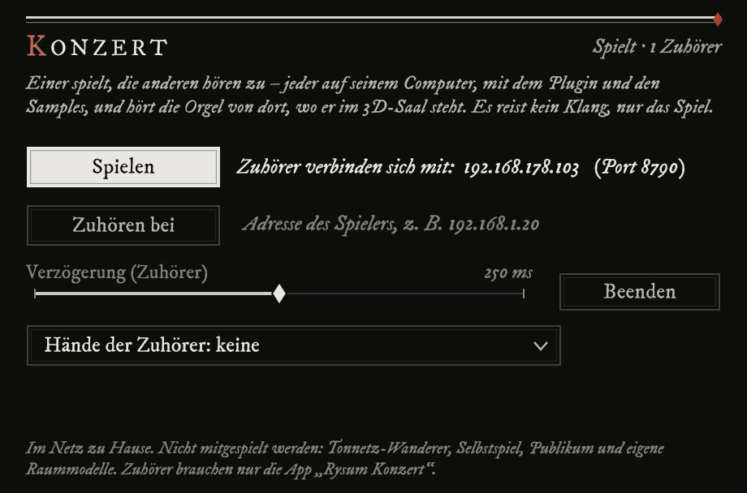

One person plays, others listen, each on their own computer with the plugin (best the standalone)
and the samples. **No sound travels over the network, only the playing**: every listener's computer
renders the organ itself, from wherever they stand and walk in the 3D Saal, with their own output
(headphones, loudspeakers, AmbiX).

- Open it from the patch list (the name at the top left) → *Konzert …*.
- **The player** clicks *Spielen*. The window shows the address listeners use (this computer in
  the home network, port 8790). The first time, Windows asks whether the program may use the
  network: allow it for private networks.
- **A listener** types that address and clicks *Zuhören bei*. Within a moment they have the
  player's whole sound: stops, every slider, layouts, paths, modulation, the Verlauf, the tuning.
  Then they hear what the player plays, *Verzögerung* later (250 ms by default; more if the network
  is uneven, less to be closer). Notes held down when someone joins sound for them too.
- What is mirrored: the MIDI the player plays (after *Halten* and the controller assignments, also
  the computer keyboard and the on-screen keys), every parameter change, every other change of the
  sound (a new patch, a moved pipe, a drawn path, a Verlauf edit), and 20 times a second the
  clocks that move things – the motions of the stops, the LFOs and the Verlauf clock – so pipes
  fly in the same places at the same moments.
- The player's hands in the 3D Saal come along too: pipes that are bodies in the Saal (*Schweben*,
  *Flug*, *Fall*, *Schwarm*, *Strömung*) are where the player's are – thrown, carried, pushed by a
  shockwave, called home, arranged – sent 50 times a second while they move. Their knocks, claps,
  bowed pipes and the lengths of *Wachsen & Brechen* are heard at the listener as well, from the
  listener's own place.
- Everyone in the Saal is a figure the others see: the player and every listener, with their names
  over their heads (red dots on the map). A listener sets their name in the listener app.
- The player's audio input (*Eingang*) travels too: while it is on, the input goes out as plain
  16-bit audio (about 1.5 Mbit/s per listener) on the player's clock, and every listener places and
  processes it themselves, in time with the notes. Lucier works at the listener on that input.
- **The listeners' hands**: in the Konzert window the player chooses what listeners may do in the
  3D Saal - nothing (the default), knock, push with the shockwave and clap, or everything: also
  carry and throw pipes, call them home, whirl and sound pipes by holding them. What a listener
  does happens at the player (who stays in charge), so everyone sees and hears the same; a pipe in
  a listener's own hand follows that hand at once on their screen. Otherwise, while listening the
  3D Saal only walks and looks: the room model buttons and the Saal's settings are the player's.
- What stays the listener's: output format, headphone and loudspeaker settings, the volume, the
  samples folder and where they stand. A listener's own changes of the player's controls go back
  to the player's within half a second. *Beenden* gives the listener their own setup back.
- If the player stops or the connection breaks off, the listener's organ falls silent; the
  listener keeps trying to reconnect and joins again (with the notes held down at that moment).
- While someone listens, saving (the standalone on quit, a host's project) keeps their own setup,
  not the player's piece.
- Not mirrored yet (the Tonnetz-Wanderer and *Selbstspiel* stay off at listeners): the
  Tonnetz-Wanderer, *Selbstspiel*, *Publikum* and loaded room models other than the six built-in
  ones. MIDI Tuning SysEx is not forwarded (Scala files are).
- For now this is for one home network: a player on the internet needs a relay server (planned).
  Both sides must have the same version of the plugin.

#### Rysum Konzert – the app for listeners

Listeners do not need the organ itself: *Rysum Konzert* is a program of its own that is only the
3D Saal and a line to join a player – nothing in it plays the organ (it opens no MIDI). The
samples come with it: hand out the zip (build the target `RysumKonzertZip`; it holds the program
and the folder `rysum-samples` next to it), unpack it anywhere and start the program.

- At the top: the player's address, *Zuhören* / *Verlassen*, the delay (more = safer on an
  uneven network), how one hears (*Binaural* for headphones by default, stereo, loudspeakers …),
  the volume and *Audio …* (output device, sample rate, buffer).
- Below, the Saal: W A S D to walk, drag the mouse to look, space to jump, I for the immersive
  view, L for the light, H to leave the ears where one stands.
- The address, delay, output and volume are remembered (in AppData, folder Rysum).
- The player still uses the organ (standalone or plugin) and *Konzert … → Spielen*; player and
  listener app must come from the same version.

## 4. MIDI

MIDI note = sounding pitch (C2 = 36 … a″ = 81). Velocity shapes the key clicks: a light touch
gives a quieter and duller click, also when the key comes up. C♯2, D♯2, F♯2, G♯2 and g♯″ do not
exist on the organ and stay silent (short octave). Sustain pedal (CC64) works.

With a free tuning (Scala or MTS-ESP, Klang page) every MIDI note 0–127 on every channel can sound,
each at the pitch the tuning gives it (see *Stimmung*). MIDI Tuning Standard SysEx is read there.
The pitch wheel and velocity are also modulation sources (*Tonhöhenrad*, *Anschlag*).

With *MIDI-CC an* (Klang page):

| CC | function |
|----|----------|
| 11 | Wind (global) / swell |
| 20–26 | stops on/off (Praestant, Gedackt, Octave 4′, Octave 2′, Sesquialtera, Mixtur, Trompete) |
| 19 | Praestant 16′ on/off |
| 27–33 | stop wind (same order) |
| 34 | Praestant 16′ wind |
| 66 | Freeze (sostenuto pedal) |
| 1 | Tremulant depth (mod wheel) |
| 64 | Sustain |

All stops and settings are plugin parameters, so they can be automated or
MIDI-learned in Reaper.

### Your own knobs and faders (MIDI learn)

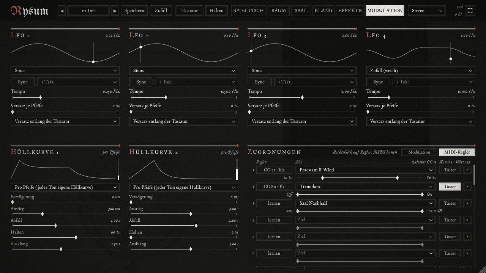

The knobs, faders and pads of a MIDI keyboard send *control change* messages (CC): a
controller number (0–119) and a value 0–127, on a MIDI channel. A host like Ableton maps
them to plugin parameters itself (MIDI Map mode). Rysum can also do this on its own, and that
works the same way in Ableton, Reaper and the standalone app:

- **Right-click any slider → *MIDI lernen***, then move the knob. The slider shows
  *MIDI: Regler bewegen …* while it waits, and afterwards a small *CC 21* tag next to its value.
  The same menu removes the assignment.
- **Modulation page → Zuordnungen → *MIDI-Regler*** shows all 32 assignments:
  - *lernen*: click it, move a controller (click again to cancel). It shows the CC number and
    channel (*K2*) it learned. Only that channel counts.
  - *Ziel*: any parameter, including switches like stops, Freeze and Tremulant.
    Picking a target in an empty row starts learning right away.
  - Range (the bar with two lozenges): the controller sweeps from the left lozenge (knob down)
    to the right one (knob up). Swap them to reverse the direction. Double-click = full range,
    Shift = 5 % steps. The values are shown at both ends.
  - *Taster*: for buttons and pads. Every press switches between the two ends of the range.
    It is on by default for switches.
  - ×: remove.
  - Top right shows the last controller that came in (number, channel, value). Use it to find
    out what a knob sends.
- A learned CC takes precedence over the fixed mapping above. For example, if you learn CC 11
  onto something else, it no longer moves the global wind. The fixed mapping can be switched off
  completely (*MIDI-CC an*). Learned assignments always work.
- The assignments belong to your setup, not to the sound. They are saved in the project / session
  and in `Documents\Rysum\MIDI-Regler.xml`, and every new instance starts with the last ones
  used. Patches do not change them.
- The parameter moves exactly as if you turned it with the mouse. When Ableton or Reaper record
  automation, the knob movement is recorded too.

## 5. Files

The maintained application is in `plugin/`. Repository-wide utilities are in
`scripts/`; sample preparation and analysis are documented in `scripts/README.md`.
`docs/` contains the current [macOS build guide](docs/MAC_BUILD.md),
[Testton documentation](docs/DSF_TEST_TONE.md) and
[structure review](docs/STRUCTURE_REVIEW.md).
Ongoing pitch research and reports are in `docs/in-progress/`;
stereo and release-velocity plans are in `docs/to-do/`. Historical source copies, extracted
notes and original photos are retained in `_archive/` and are not built.

All paths in the following tree are relative to the repository root.

```
plugin/
  CMakeLists.txt        build description
  source/               C++ code
    OrganEngine.*       voices, loops, releases, noise layer, encoder, degradation
    SampleLibrary.*     reads rysum_samples.json + WAVs, replaces unusable pipes
    Spatial.h           AmbiX encoder (ACN/SN3D), stereo panning, layouts, motion
    Degrade.h           "Verfall"
    PluginProcessor.*   parameters, state, sample loading
    Convolver.*         impulse-response reverb (stereo / AmbiX)
    Binaural.*          HRTF sets (built-in FABIAN, SOFA via libmysofa), MagLS design, binaural decoder
    SofaGunzip.cpp      zlib inflate for libmysofa (JUCE's zlib)
    Modulation.h        LFOs, envelopes, routing definitions
    RoomSim.h           simulated room: image sources, Eyring, ray tracer
    RoomTail.*          late reverb of the simulated room: synthesised responses, partitioned convolution
    Scala.h             Scala files (.scl scales, .kbm keyboard mappings)
    WindChaos.h         wind model "instabil": resonances, intermittent speech, hiss of starving pipes
    PluginEditor.*, ConsoleView.*, SpaceView.*, SaalView.*, KlangView.*, EffectsView.*, ModView.*,
    MidiMapView.*, Theme.h   interface
  resources/            photos, fonts (OFL), grain texture, fabian_hrir.bin (FABIAN HRIRs)
  third-party/libmysofa/ SOFA reader (BSD-3, see its LICENSE and README_RYSUM.txt)
  third-party/MTS-ESP/   MTS-ESP client by ODDSound (0BSD, see its LICENSE and README_RYSUM.txt)
  tests/                offline render test + UI snapshot tool (optional)
```

Optional tests (not needed for normal use):
`cmake -B build -DRYSUM_BUILD_TESTS=ON` builds `RysumRenderTest` (renders MIDI scenes
to WAV and checks the encoder maths) and `RysumUiSnapshot`.

Fonts: "Rysum Fell" = IM FELL DW Pica by Igino Marini with a few symbols (arrows, primes, ♯ …)
added from DejaVu Serif and renamed as the OFL requires (built by `scripts/make_fell.py`);
UnifrakturMaguntia for the title; IBM Plex (no longer used in the interface). All SIL Open
Font License (see `plugin/resources/OFL_*.txt`).

HRTF: FABIAN head-related transfer function database, Audio Communication Group, TU Berlin –
F. Brinkmann et al., "A High Resolution and Full-Spherical Head-Related Transfer Function
Database for Different Head-Above-Torso Orientations", JAES 65(10), 2017, data DOI
10.14279/depositonce-5718, licence CC BY 4.0 (see `plugin/resources/FABIAN_LICENSE.txt`).
SOFA files are read with libmysofa by Christian Hoene / Symonics (BSD 3-clause).
Microtuning via the MTS-ESP client library by ODDSound Ltd. (0BSD).
