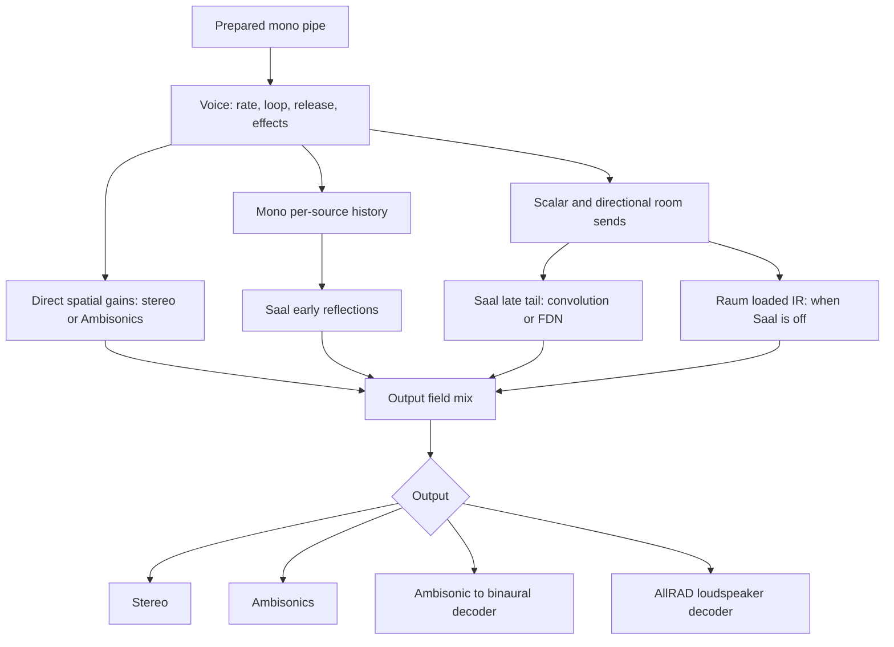

# Stereo source preservation: Raum, Saal and output mapping

Code review: 8 November 2026. This is an architectural proposal, not a change to playback.

## Main conclusion

Keep the stereo recording as a source asset. Mono conversion should be an explicit source/spatial-rendering policy, not an irreversible property of every loaded sample. Neither Ambisonic output nor binaural decoding inherently requires the original recording to be collapsed to mono. The current point-source and room-excitation algorithms operate on scalar signals; stereo can instead be represented as two mapped emitters.

A microphone pair is not automatically two physical pipe positions. Two-emitter rendering gives an explicit spatial interpretation of the stereo recording; it does not reconstruct the original acoustic field.

Sample range must also remain bounded: moving an end sample far into the high or low register changes its character and does not supply the spatial identity of a newly recorded pipe. Register metadata should define the supported sounding range and permitted source transpositions. Keep the source pipe's position as the spatial centre of either its mono emitter or stereo pair; any virtual relocation is a separate choice. Beyond the declared limits, that register should remain silent rather than repeatedly stretching an edge sample. The numerical limits should be established by listening tests for each register, with explicit exceptions for intentionally derived registers. See the [range and transposition policy](SAMPLE_TUNING_IMPLEMENTATION_PLAN.md#bound-sample-range-and-transposition).

## Where information is currently lost

1. `scripts/rysum_preprocess.py` defaults to mono before note detection, timing and loop analysis. It aligns the microphone signals and compensates summing loss; where unsuitable it selects one channel. Its existing `--stereo` option retains channels, but the cleaning branch is mono-only, so it is not an equivalent stereo version of the entire cleaning pipeline.
2. `plugin/source/SampleLibrary.cpp::readMono` averages decoded channels into one `Sample::data` vector. Stereo files would therefore still become mono even if preprocessing retained them.
3. `OrganEngine::Voice` reads one signal with one sample cursor into a mono voice buffer. Per-voice filters, freeze/grains and effects are built around this buffer before spatial gain encoding.

Stereo preservation therefore requires an asset/voice change, not just moving one downmix line to the final decoder.

## Current signal map

This diagram omits supplementary noise/echo inputs and the two Lucier processing stages for readability. These join or transform the same field/send paths; see the table below. Raum's IR receives separate sends, rather than simply convolving the complete dry output mix.

## Stage-by-stage boundaries

| Stage | Current representation | Where a stereo source could remain stereo |
|---|---|---|
| Asset decoding | Channels averaged by `readMono`; one stored array | Store mono or stereo channels as provided, with shared frame count/rate and source metadata |
| Voice playback | One cursor, one mono signal and scalar DSP state | Shared cursor/rate/loop/release timing for L/R; separate channel filter histories, with shared note/control events |
| Direct spatial placement | One signal multiplied by stereo/Ambisonic gains | Mono policy: one emitter; stereo policy: L/R as two explicitly positioned emitters with width/orientation |
| Raum directional IR sends | `C0`, plus cosine/sine harmonics of each point-source azimuth | Feed L and R into the same harmonic buses at their mapped directions; no separate full convolver per pipe is required for linear accumulation |
| Raum late IR field | Diffuse part driven by the scalar `C0`; stereo-IR/stereo-output special case also has one excitation input | Keeping a stereo dry image does not make this wet excitation stereo. Retain the intentional scalar excitation initially; independent stereo excitation requires another wet-path design |
| Saal early reflections | One mono history/ring and one source position per reflection slot | One collapsed emitter, or two independent emitter histories/positions; the latter increases slot and processing demand |
| Saal late convolution | One scalar excitation for each active simulated room, producing stereo/Ambisonic output | A deliberate diffuse excitation boundary. Stereo direct/early paths can remain intact while this send is mono |
| Saal FDN | One scalar input feeding its internal delay-line field | Same policy as the late convolution; independent stereo excitation would be an extension |
| Echoes | Captures stereo mid or Ambisonic W, then places repeated signals spatially | Currently an intentional mono-excitation effect; would need a separate stereo-echo option to retain source side information |
| Lucier live effect | Stereo mid or Ambisonic W through an iterative room response | Conceptually mono excitation in the current effect; preserve it as an explicit choice |
| Lucier recording/piece | Records stereo mid, input mid or Ambisonic W | Also explicitly mono today; stereo source storage alone does not change it |
| Binaural decoding | Ambisonic channels to L/R through HRTFs | Does not collapse the original source. Two encoded emitters can pass through this same decoder |
| Ambisonic export | The encoded field channels | Two emitters can be summed in the field before export |
| AllRAD speakers | Ambisonic field decoded to speakers | The same stereo-emitter interpretation can feed it |

Raum loaded-IR wet processing is skipped while Saal is enabled (`PluginProcessor::processBlock`). They are alternate wet-room paths in the current design, not two automatically stacked reverbs. Dry level control still applies. Recorded ambience already present in source samples remains part of those samples.

## Proposed first implementation

### Preserve original channels

Extend the asset representation with channel count and per-channel data. All channels share sample rate, frame indexing, playback cursor, retuning and loop/release timing. Do not independently realign L/R in stereo mode, choose different loop endpoints per channel, or run unrelated random voice decisions for each side.

Prepare stereo crops with shared edit points. Validate the loop seam on both channels; a good mono-loop correlation does not establish that both channel seams are good. Retain raw stereo and the mono-conversion recipe as separate metadata. Cleaning stereo should preserve channel relationships and noise characteristics rather than silently applying two unrelated normalization decisions.

### Offer source rendering policies

- **Mono point source:** use a prepared or background-generated compatible mono view, then the existing algorithms. Reuse the current alignment/channel-selection recipe where appropriate; a naive L+R sum may cancel important recorded components.
- **Stereo spatial pair:** play L/R together and map them around the pipe's current spatial centre, with width/orientation. Encode both into the same stereo or Ambisonic field. First use this for direct sound; reflection handling can remain an explicit mono-excitation policy until extended.

A zero-width pair collapses the directions but can still produce summing cancellation; it is not automatically equivalent to the existing compensated mono preparation. Define gain and width behaviour explicitly, including the levels for identical channels, uncorrelated channels and opposite-polarity channels.

Avoid adding a headphone-only raw-stereo bypass as the default: it would bypass Ambisonic head rotation and would not export equivalently. Such a bypass could exist as a separately labelled monitor mode later.

### Keep room boundaries explicit

For the first version, preserve stereo for the direct path and use the compatible mono view for Saal early reflections and scalar late sends. This is a controlled hybrid, not fully stereo room excitation. Raum directional early IR sends can later use the two emitter positions with the existing harmonic-bus machinery. Two-emitter Saal early reflections come after profiling: the current reflection-slot budget is shared across voices and input sources.

Late reverberation can remain scalar-excited while producing a spatial field. If preserving stereo differences through the wet field becomes a requirement, add a separately defined multi-input model rather than pretending that a scalar send preserves those differences.

## Tests before adoption

1. Existing mono assets produce equivalent output.
2. L/R use identical sample position, tuning, loop wrapping and release transitions.
3. Identical channels, hard-left/hard-right signals, uncorrelated noise and L = -R give documented level/width behaviour; no automatic phase inversion or clipping fix is hidden.
4. Mid/side-correlated fixtures expose unexpected mono cancellation. Stored stereo remains recoverable even when a processing branch intentionally uses mono.
5. Binaural head rotation and Ambisonic export respond to both emitter positions. Check stereo and speaker outputs too.
6. Dry-only, Raum-only and Saal-only comparisons isolate downmix boundaries, tail behaviour and gain changes.
7. Native 44.1/48 kHz assets retain correct frame timing at multiple output rates.
8. Profile high polyphony and early-reflection slot usage. Keep one logical note/voice identity and shared expression for a pair; do not double MIDI ownership merely to render two audio channels.

## Relation to the tuning work

The pure `SamplePitch` adapter remains useful unchanged: one playback rate controls all channels of an asset. Keep raw source pitch separate from spatial rendering. Add channel-aware source storage and region metadata before importing stereo Norrfjärden recordings; full stereo spatial rendering can be a following stage. Do not regenerate the Rysum sample set automatically during this design work.

## Recommended actions and completion criteria

These are planned actions, not completed implementation. Follow the tuning work in [the sample implementation plan](SAMPLE_TUNING_IMPLEMENTATION_PLAN.md); stereo support should build on the same asset and pipe definitions.

1. **Finish the pure tuning adapter and tests first.** Establish one source-frame increment for the whole asset, independent of its channel count. Check native/corrected tuning, register ratios and different file/output rates. Stereo must not acquire a separate tuning calculation or MIDI voice identity for each channel.
2. **Extend the portable asset definition and loader.** Preserve channel count, native sample rate, shared frame regions, raw pitch calibration and source provenance. Decode original stereo into channel-aware storage instead of calling `readMono` universally. Keep an adapter for existing mono Rysum assets. Completion: mono assets still load, and both channels of an imported stereo asset remain available with their original alignment and resolution.
3. **Define the compatible mono view.** Retain original L/R unchanged; describe the mono recipe separately, including alignment lag, channel selection and normalization. Generate any needed view during preparation or background loading, not through correlation analysis in the audio callback. Completion: the mono path has documented gain/cancellation behaviour and can reproduce the existing mono preparation where its recipe is available. Budget memory explicitly if retaining both stereo and cached mono data.
4. **Make stereo preprocessing a supported path.** Review the current `--stereo` cleaning difference. Use shared crop, loop and release coordinates, and validate seams on both channels. Preserve native source rates and bit depth; do not send imported PCM24 recordings through the existing PCM16 export by default. Completion: stereo preparation retains interchannel timing and does not independently normalize or retune the two sides.
5. **Add synchronized stereo voice rendering.** Share playback position, pitch, note expression, loop decisions, release transitions and random control decisions; give each channel the filter/history state it needs. Adapt freeze/grains and other per-voice effects deliberately rather than reading only one channel. Completion: channel alignment survives retuning, looping, sustain and release, with no change to mono playback.
6. **Expose source rendering policy and the stereo direct path.** Offer mono point-source rendering and a spatial stereo pair, with explicit width, orientation and level rules. Encode both emitters into the existing output field so stereo, binaural, Ambisonic and loudspeaker outputs use the same interpretation. Preserve the choice in register/patch state with backward-compatible defaults. Completion: both sides respond correctly to spatial movement and head rotation, and identical/opposite-polarity fixtures have predictable results.
7. **Retain explicit mono room excitation for the first release.** Use the compatible mono view for the existing Saal early-reflection history and scalar late-room sends. Keep the current Raum/Saal wet-path selection. Document that this preserves stereo direct sound while the room excitation is mono; it is not a fully stereo wet path. Completion: dry-only, Raum-only and Saal-only comparisons show the intended boundaries without unintended gain jumps or tail truncation.
8. **Extend directional wet processing after the first version is stable.** Feed stereo-pair emitters into Raum's directional harmonic sends. Then profile two-emitter Saal early reflections, including reflection-slot exhaustion at high polyphony. Keep late convolution/FDN excitation scalar unless there is a separate requirement and design for multiple independent inputs. Completion: measured CPU, memory and slot use justify the extension; the direct path remains consistent between room choices.
9. **Keep mono-excitation effects explicit.** Echoes and both Lucier paths currently use stereo mid or Ambisonic W. Retain that documented behaviour initially. Any stereo-preserving alternative needs its own effect design and tests, rather than being implied by stereo asset storage.
10. **Validate one imported register before broadening the library.** Test the Norrfjärden register at its native file rate, in native and corrected tuning, with room effects disabled first. Then test mono/pair rendering and each wet-room route. Record the chosen source and processing policies in its metadata. Do not claim compound-rank tuning accuracy or complete-organ stereo support on the basis of this single-rank test.

The first stereo milestone ends after actions 1–7 and the single-register checks in action 10: preserved stereo assets, synchronized stereo direct playback, an explicit compatible mono path and documented room excitation. Actions 8–9 describe subsequent extensions or deliberate retained behaviour. None requires an immediate rewrite of the final binaural decoder or Ambisonic output format.

## Code landmarks

- `scripts/rysum_preprocess.py`: `to_mono`, `mono_track`, `process_stop`, `--stereo`.
- `plugin/source/SampleLibrary.h/.cpp`: `Sample`, `readMono`.
- `plugin/source/OrganEngine.cpp`: `renderRange` direct mix, harmonic sends and `erRing` writes; `renderRoom` late room inputs; `renderFdn`; `renderEchoes`; `renderLucier`.
- `plugin/source/OrganEngine.cpp::renderInput`: an existing two-emitter stereo-input precedent, with width and shared room routing.
- `plugin/source/PluginProcessor.cpp::processBlock`: room selection, dry/wet mix, Lucier piece and final binaural/speaker decoding.
- `plugin/source/Convolver.h/.cpp`: directional early IR and scalar late excitation; mono-to-stereo special case.
- `plugin/source/RoomTail.h`: scalar-input `TailConvolver::process`.
